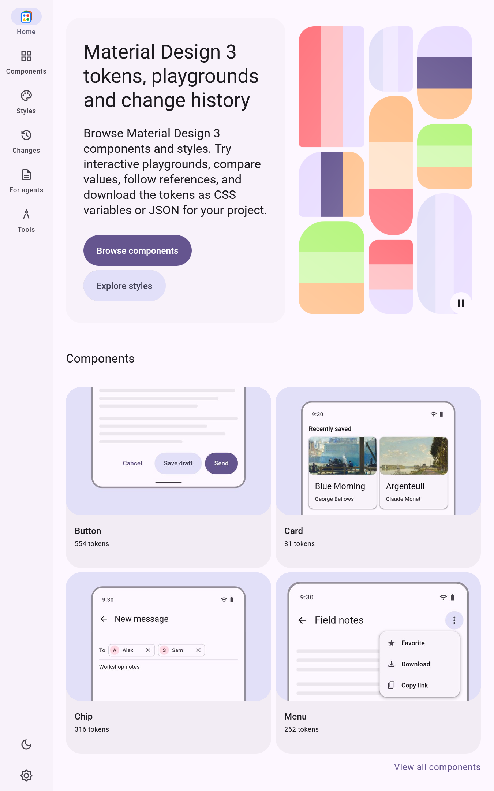
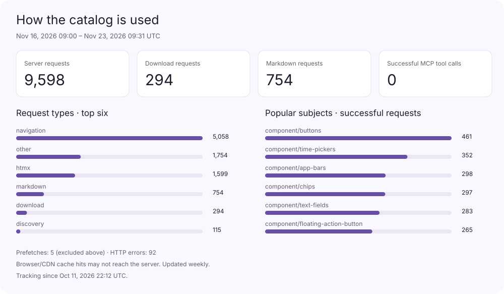

# Token Catalog

Token Catalog collects design tokens so you can browse, compare, and download
them. [Material Design 3](https://tokencatalog.dev/md3/) is the first supported
collection.

Tokens, references, and context-specific values are available as server-rendered
HTML, Markdown, JSON, and read-only MCP tools—no account or JavaScript required.
Source links connect every token back to its original design guidance.

[](https://tokencatalog.dev/md3/)

## Browse and download

Find tokens by component or style, follow their reference chains, and filter
values by platform, theme, contrast, or size. Download the filtered rows, a
complete table, a component, or the full collection as DTCG JSON, CSS variables,
or source JSON. You can also download a standalone component implementation with
CSS, example HTML, and required JavaScript.

The change log compares retained captures and records when values were added,
removed, or changed across contexts. Incomplete captures are marked as partial.

See [usage](docs/usage.md) and [API and agent access](docs/reference/agents.md).

## Component playground and motion tools

Component pages include interactive playgrounds for variants, sizes, and states,
built from CSS generated out of the captured tokens with authored HTML and
browser behavior.

The [tools page](https://tokencatalog.dev/md3/tools) also hosts two client-side
browser apps built with the same Forge components:

- [Material Motion Lab](https://tokencatalog.dev/tools/motion-lab/) ([source](https://github.com/sojupie/material-motion-lab)):
  tracks UI movement in local video recordings and compares curves against
  Material Design 3 motion tokens. Videos and `.motion` projects stay on your
  device.
- [Carousel playground](https://tokencatalog.dev/tools/carousel-playground/) ([source](https://github.com/sojupie/carousel-motion-lab)):
  tests and records carousel settling behavior across implementations.

## Use with your agent

[Give this to your agent](https://tokencatalog.dev/md3/for-agents) has a copyable
prompt, skill install command, and MCP URL.

Prompt:

> Use Token Catalog at https://tokencatalog.dev/md3 to find the Material Design 3
> tokens for this task. Read its agent guide, fetch the relevant component or
> style, and preserve the token references and selected context.

Installable skill:

```sh
npx skills add sojupie/tokens --skill token-catalog
```

Streamable HTTP MCP server (no account or API key):

- URL: `https://tokencatalog.dev/md3/mcp`
- Start with `list_subjects`, then call `get_tokens` with the returned kind and slug.

See [API and agent access](docs/reference/agents.md) for endpoints and formats.

## Usage



Updated weekly from retained server request totals (prefetches counted separately).

## Repository layout

One Go module and CLI (`cmd/tokens/`) covers three parts:

| Part | Responsibility | Source |
| --- | --- | --- |
| Source | Captures upstream data, verifies snapshots, compares changes, builds publications, and exports DTCG | [`source/`](source/) |
| Catalog | Serves token tables, filters, downloads, history, API/MCP interfaces, and usage reports | [`catalog/`](catalog/) |
| Forge | Generates CSS and component token bindings, implements browser behavior, and runs conformance checks | [`forge/`](forge/) |

[`skills/`](skills/) holds the installable agent skill and hosted API guide.
[`deploy/`](deploy/) holds Docker, systemd, and update scripts. See
[architecture](docs/architecture.md) for the data pipeline and component authoring map.

## Run locally

Requires Go 1.26+.

```sh
go build -o ./bin/tokens ./cmd/tokens
./bin/tokens serve --published published --listen 127.0.0.1:8081
```

Open [localhost:8081](http://127.0.0.1:8081) to browse a saved publication. On
Windows, build and run `bin/tokens.exe`.

### Build a Material Design 3 publication

For a fresh checkout (requires Chrome or Chromium):

```sh
./bin/tokens crawl
./bin/tokens snapshot create
./bin/tokens snapshot verify
./bin/tokens publish
```

See [development](docs/development.md) for tests, CSS builds, and adding another
design system, or [deployment](docs/operations/deployment.md) for Docker and
scheduled updates.

## Documentation

- [Using the catalog](docs/usage.md)
- [Developing and contributing](CONTRIBUTING.md)
- [Architecture](docs/architecture.md)
- [Reference](docs/README.md#reference)
- [Operations](docs/README.md#operations)
- [Project history](docs/history/README.md)

## License and attribution

Original code, schemas, and documentation use the [Apache License 2.0](LICENSE).
Material Design 3 data comes from Google and retains its upstream terms. Bundled
fonts, icons, and dependencies retain their own licenses.

Token Catalog is an independent project. See [third-party notices](THIRD_PARTY_NOTICES.md)
and [licensing and source attribution](docs/licensing.md).
