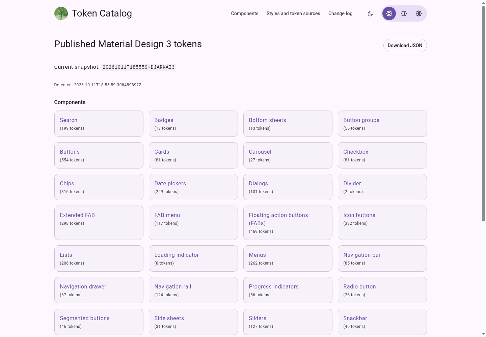
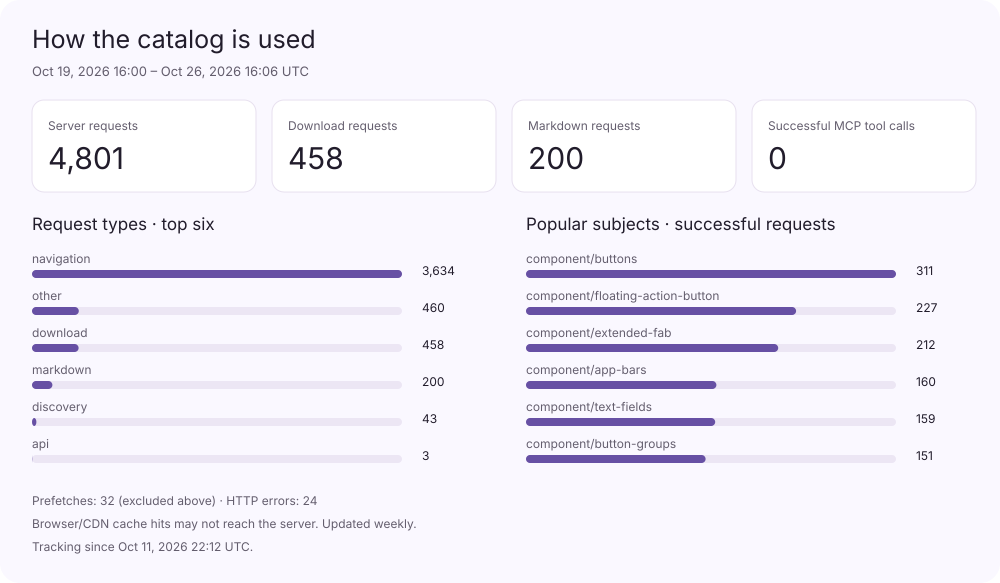
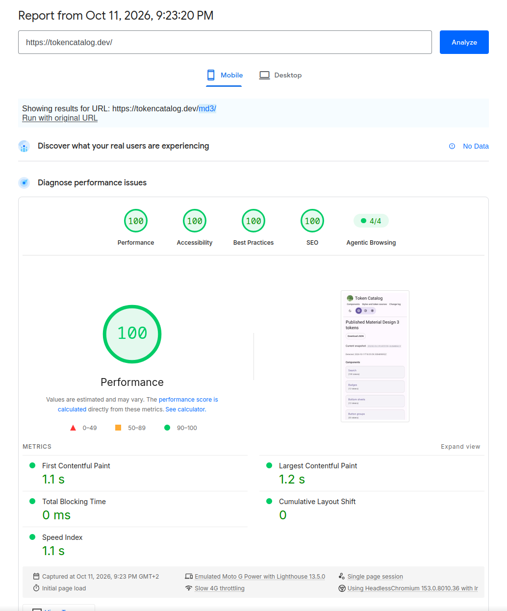
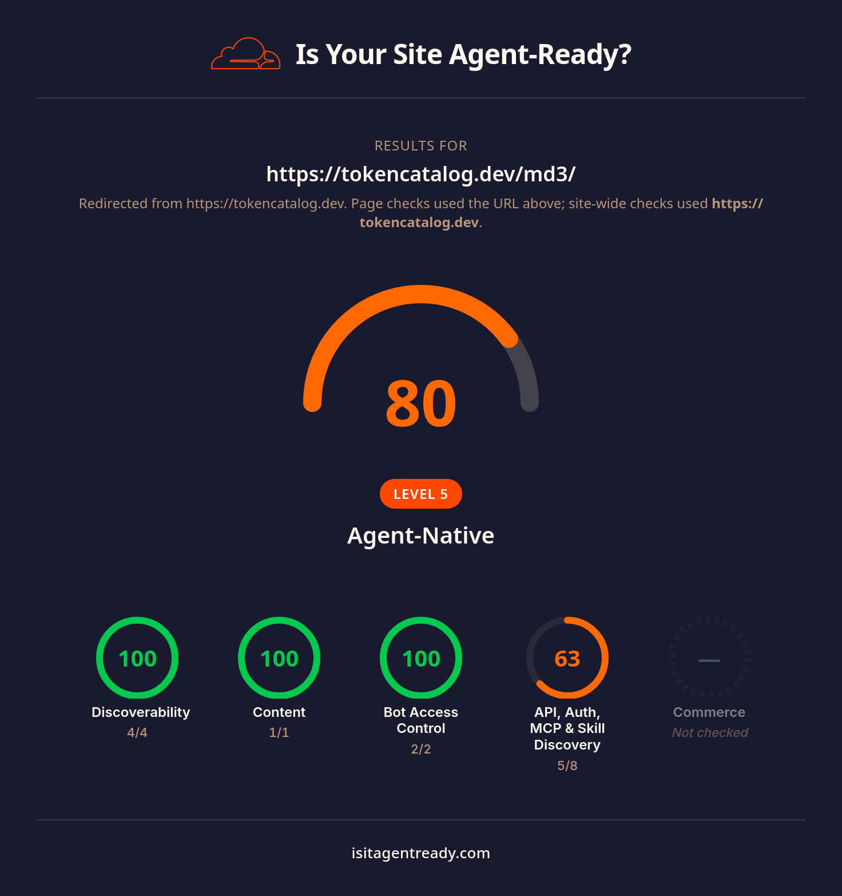

# Token Catalog

Token Catalog collects design tokens and makes them easier to browse, compare
and download. [Material Design 3](https://tokencatalog.dev/md3/) is the first
supported collection.

The goal is fast, direct access to design data for developers and [agents](#use-with-your-agent). Tokens,
references and settings are available in readable pages and structured responses
that can be inspected, crawled and fetched with ordinary HTTP clients. Source
links connect the data to the original design guidance.



## Browse and download

Find tokens by component or style, inspect their references, and filter values
by platform, theme and other settings. Downloads can include the filtered table,
all values in a table, a whole component, or the collection.

For example, select a Buttons table, choose a platform and theme, then download
“This table, with your filters” to export that selection. Broader download
options include values outside the selected table and filters.

The change log compares retained captures. It shows added, removed and changed
values, including changes to individual settings. Dates record when a change
was observed. Incomplete captures remain marked as partial.

The same data is available through a public JSON API, Markdown responses and
read-only MCP tools. See [usage](docs/usage.md) and
[API and agent access](docs/reference/agents.md).

## Use with your agent

[Give this to your agent](https://tokencatalog.dev/md3/for-agents) has a copyable
prompt, skill install command, and MCP server URL.

Give your agent this instruction:

> Use Token Catalog at https://tokencatalog.dev/md3 to find the Material Design 3
> tokens for this task. Read its agent guide, fetch the relevant component or
> style, and preserve the token references and selected context.

For agents that support installable skills:

```sh
npx skills add sojupie/tokens --skill token-catalog
```

The installer lets you choose your agent. The [skill](skills/token-catalog/SKILL.md)
lives in this repo and reads the current API guide from the site. You do not need
to clone or run the catalog to use its data.

If your client supports MCP, add `https://tokencatalog.dev/md3/mcp` as a
Streamable HTTP server. Start with `list_subjects`, then call `get_tokens` with
the returned kind and slug. No account or API key is required.

Example requests:

- “Find the filled button tokens for Android in the dark theme.”
- “Compare the corner tokens for cards and dialogs.”
- “Check which motion token values changed between retained captures.”

See [API and agent access](docs/reference/agents.md) for setup and data formats.

## Usage



The graphic updates weekly from retained server totals. Counts include automated
traffic and validation requests; they are not unique visitors. Prefetches are
separate, and browser or CDN cache hits may not reach the server.

## Performance and access

Pages render on the server with the token data already present in the HTML.
Reading pages and fetching JSON do not require JavaScript or an account.
Markdown responses, OpenAPI, discovery files and MCP tools make the same data
available to different clients. Small assets and deferred scripts keep the
browser's initial work limited.

The October 11, 2026 [mobile PageSpeed Insights report](https://pagespeed.web.dev/analysis/https-tokencatalog-dev/91lzhrkat6?hl=en&form_factor=mobile)
scores 100 for performance, accessibility, best practices and SEO, with 4/4
agentic browsing checks passed. The measured largest contentful paint is 1.2 s,
with 0 ms total blocking time and no layout shift.

The captured [Is It Agent Ready?](https://isitagentready.com/) check scores 80/100,
including 100 for discoverability, content and bot access control.
The remaining three checks concern OAuth/OIDC discovery, protected-resource
metadata and agent registration. Token Catalog provides public, read-only access
without accounts or protected APIs, so those authentication features are
deliberately omitted. The lower score reflects those checks being counted as
missing even though the discovery and access checks for the public service pass.

<a href="https://pagespeed.web.dev/analysis/https-tokencatalog-dev/91lzhrkat6?hl=en&amp;form_factor=mobile"></a>


## How it works

A Go pipeline opens source pages with Chromium, captures their token payloads,
and saves the source URLs, coverage results and SHA-256 hashes. Each snapshot
contains the captured data and the files needed to verify it later.

Publication runs offline. It compares snapshots and builds a SQLite read index
and JSON downloads. The Go server renders pages with templ and HTMX, serving
saved data independently of the crawler and upstream website.

The project grew out of using Material Design in a web application and needing
its token values in a form that could be inspected and consumed directly.
[Architecture](docs/architecture.md) explains the pipeline and its boundaries.

## Run locally

Install Go 1.26 or newer and Chrome or Chromium, then run:

```sh
go build -o ./bin/tokens ./cmd/tokens
./bin/tokens crawl
./bin/tokens snapshot create
./bin/tokens publish
./bin/tokens serve --published published --listen 127.0.0.1:8081
```

Open [localhost:8081](http://127.0.0.1:8081). The initial crawl needs network
access. Later starts only need the serve command. On Windows, build
`bin/tokens.exe` and use that executable for the same commands.

See [development](docs/development.md) for tests and template changes, or
[deployment](docs/operations/deployment.md) for Docker and scheduled updates.

## Scope

The current crawler, extractor and publication format are specific to Material
Design 3. Other design systems would need source adapters, extraction rules and
their own attribution. The catalog can grow to include further collections;
only Material Design 3 is implemented today.

Captures cover the reviewed source-page catalog. Upstream failures and missing
payloads affect coverage. A token's appearance or disappearance in a partial
capture does not establish that its source added or removed it.

## Documentation

- [Using the catalog](docs/usage.md)
- [Developing and contributing](CONTRIBUTING.md)
- [Architecture](docs/architecture.md)
- [CLI, snapshots and publication](docs/README.md#reference)
- [Deployment and recovery](docs/README.md#operations)
- [Project history](docs/history/README.md)

## License and attribution

Project code and original documentation are licensed under [MIT](LICENSE).
Material Design 3 data comes from Google and retains its upstream terms.
Bundled fonts, icons and dependencies retain their own licenses.

Token Catalog is an independent project. See [third-party notices](THIRD_PARTY_NOTICES.md)
and [licensing and source attribution](docs/licensing.md) for the distinction
between the software and the data it publishes.
